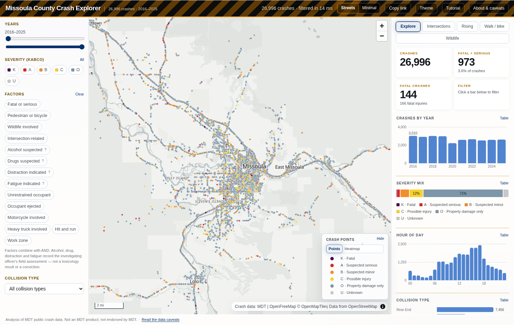

# MDT Crash Dashboard

An interactive crash map for any Montana county, built on your own machine from
the Montana Department of Transportation's published crash database.

Answer five questions, and the tool downloads MDT's spreadsheets, filters them
to your county, derives what the maps need, and serves a dashboard at
`localhost`. Nothing is uploaded, no account is needed, and no part of it calls
out to a server you do not control once the data is on disk.



---

## Quick start

Requires **Node 22.12 or newer**. Works on Windows, macOS and Linux.

```bash
git clone https://github.com/mfstone/mdt-crash-dashboard.git
cd mdt-crash-dashboard
npm install

npm run setup     # five questions: source, tables, county, colours, basemap
npm start         # downloads, builds, opens the dashboard
```

The first run downloads about 150 MB from mdt.mt.gov and takes a few minutes,
most of it spent streaming 800,000 spreadsheet rows. Later runs reuse the
download and rebuild only what changed.

A pre-built bundle for **Missoula County** is committed, so `npm run build &&
npm start` shows you a working dashboard immediately, before you decide whether
to spend the download.

### The commands

| Command | What it does |
|---|---|
| `npm run setup` | The wizard. Writes `crashmap.config.json`. |
| `npm run data` | Fetch (if needed) and rebuild the data bundle. |
| `npm run build` | Generate the theme, build the static site. |
| `npm start` | Rebuild whatever is stale, then serve and open the dashboard. |
| `npm test` | Build a server, drive it with a real browser, verify the decode. |

`npm run setup` is scriptable, which matters for a Dockerfile or a CI job —
Node's readline cannot be driven by a pipe, so a prompt-only wizard can only
be tested by a human typing at it:

```bash
npm run setup -- --county="Lewis And Clark" --tables=all \
  --primary=#002F6C --secondary=#EAAA00 --accent=#B9975B \
  --basemap=openfreemap-liberty --yes
```

---

## What you can configure

Everything lives in one file, `crashmap.config.json`, written by the wizard and
safe to hand-edit — every value is validated, and a bad one names the key, what
was found and what was allowed.

```jsonc
{
  "county": "Missoula",          // or null for a statewide build
  "source": { "kind": "url" },   // or { "kind": "directory", "path": "..." }
  "tables": ["crash", "vehicle", "person"],
  "theme": {
    "primary":   "#002F6C",
    "secondary": "#EAAA00",
    "accent":    "#B9975B"
  },
  "basemaps": ["openfreemap-liberty", "openfreemap-positron"]
}
```

**County** — any of Montana's 56, or `null` for the whole state.

**Tables** — the crash table alone is 31 MB and gives you crashes, coordinates,
severity and five of the fourteen factor filters. Adding the vehicle and person
tables costs another 120 MB and buys the other nine: alcohol, drugs,
distraction, fatigue, restraint use, ejection, motorcycle, heavy truck and
hit-and-run, plus casualty counts.

**Theme** — three brand colours, from which the whole interface palette is
*derived*, not pasted. See [Colour](#colour) below.

**Basemaps** — `openfreemap-liberty` (Streets), `openfreemap-positron`
(Muted), `openfreemap-bright`, and `none`. Free, key-less, and no account.
Name one or two: two gives the reader a toggle, labelled from the registry.

`none` is not a degraded mode. The dashboard supplies its own county polygons
and place labels, and drawing them alone is often clearer than laying them over
someone else's cartography — it also leaves a page that makes **no external
request at all**.

The choice drives the Content Security Policy. `site/public/_headers` is
generated from it at build time, so the policy permits exactly the tile origins
the configured basemaps need and nothing else. That matters because a static
header cannot change when the reader presses the toggle, and an origin missing
from it fails as a blank map with an error only the console shows.

---

## What it shows

**Explore** is the default: filter 27,000 crashes by year, severity, geography
and fourteen contributing factors, and watch every chart and the map follow.
Filtering is a typed-array scan over columnar data, so it lands in tens of
milliseconds with no server round trip.

Four reports answer questions the map alone cannot:

- **Intersections** — crash clusters ranked by fatal and serious injuries.
  Clusters are *derived*: MDT publishes no intersection inventory, so
  intersection-related crashes are snapped to a 50 m grid and adjacent cells
  merged.
- **Rising** — first half of the selected years against the second half, by
  place. Two totals rather than a fitted trend, because at these counts a
  regression line would claim precision the data does not have.
- **Walk / bike** — places ranked by pedestrian and bicycle casualties. Rare,
  and far more severe than crashes overall.
- **Wildlife** — the corridors carrying the most animal collisions. Ranked by
  volume, not severity, and the report says why.

Every report prints the gate it applied, the rows it excluded and the reason.
Where a ranking is partly arbitrary — ties at the cut, small-sample noise — it
says so on the report rather than in a footnote nobody reads.

---

## The data

Three spreadsheets, published by MDT and refreshed periodically:

| Table | Size | Rows | Gives |
|---|---|---|---|
| Crash | 31 MB | 219,000 | crashes, coordinates, severity, 5 of 14 factors |
| Vehicle | 60 MB | 344,000 | hit-and-run, motorcycle, heavy truck |
| Person | 60 MB | 455,000 | alcohol, drugs, distraction, fatigue, restraint, ejection, casualties |

They are **not committed here**. They are a third party's dataset, revised in
place without a version string, so a copy committed today is one that quietly
disagrees with the source in six months. `npm run data` fetches them and
records each file's ETag, so the next run knows whether anything actually
changed.

Point `source` at a directory instead if you already have the workbooks, or if
the machine has no internet access.

### Coordinates

MDT publishes X/Y in **EPSG:32100** (NAD83 / Montana, Lambert Conformal Conic),
reprojected here to WGS84 with proj4. Rows whose coordinate is missing or falls
outside Montana keep the crash and drop the point — the record still counts in
every total, it simply is not plotted. Coordinate coverage runs about 99.98%.

### Caveats that matter

The dashboard carries its own **About & caveats** sheet, generated from the
build, documenting all 34 fields. Three worth knowing before you draw a
conclusion:

- **Suspected serious injury is a judgement call.** Fatality is not. The two
  are not coded to one threshold across Montana, so any ranking that counts
  fatal-plus-serious is partly measuring reporting practice. The build computes
  this county's suspected-serious-per-fatality ratio against the statewide one
  and prints both.
- **There is no exposure denominator.** MDT's crash extract carries no traffic
  counts, so nothing here is a rate. A busy road accumulates more crashes than
  a quiet one at the same risk per mile. The reports say this where it applies;
  the two AADT-based screening reports this tool's ancestor had were removed
  rather than left to run on data that does not exist.
- **23 U.S.C. § 407.** Federal law makes certain highway-safety data
  inadmissible in some proceedings. The dashboard states the rule and its
  disclosure policy in full.

Crashes are included by the **county recorded on the report**, so a corridor is
cut at the county line.

---

## Colour

The three brand colours are inputs, not output. `site/scripts/build-theme.mjs`
derives the entire identity palette from them in OKLab — hue and chroma held,
lightness solved until each token clears the contrast its role requires — and
**fails the build, loudly and with numbers**, when a role cannot be satisfied:

```
--> theme from #002F6C / #EAAA00 / #B9975B
    primary L 0.319 chroma 0.117 hue 257.7
    primary on near-black 1.46:1 -> used AS the dark ground

  light (on #FFFFFF)
   --accent           #002F6C  12.94:1
   --accent-2         #A66900   4.52:1
   --accent-3         #684901   8.26:1
```

Failing is the feature. A brand palette is chosen for a letterhead, where
nothing has to clear 4.5:1 against a background it was never tested on; a
silent near-miss ships a dashboard whose muted text is unreadable for some
portion of its readers and nobody finds out.

One structural decision falls out of the primary's lightness: a deep colour
measures about 1.4:1 on near-black and cannot be a *mark* in a dark theme, so
the only honest use for it there is as the ground itself. Getting this wrong is
what makes a derived dark theme look broken.

**Semantic ramps are deliberately not rebranded.** KABCO severity, the heat
ramp and the diverging ramp encode meaning, not identity. A reader who learns
that dark purple means "fatal" should not have to relearn it because a new
county picked green. Those live in `app.css`; the identity lives in the
generated `theme.css`, which is imported after it.

---

## How it is built

```
pipeline/            Node. Spreadsheets in, data bundle out.
  wizard.mjs           five questions -> crashmap.config.json
  config.mjs           the validator; every key, every allowed value
  fetch.mjs            conditional GET, ETag cache, offline fallback
  xlsx-stream.mjs      streaming sheet reader (455k rows, ~120 MB peak)
  read-crash-table.mjs county filter applied during the pass
  read-companions.mjs  vehicle and person folds
  coding.mjs           MDT's strings -> the model
  derive.mjs           columnarise, cluster, reproject
  build.mjs            write the bundle; owns its output directory
  notices.mjs          the legal and field notices, verbatim
  start.mjs            staleness check, serve, open
  test.mjs             serve a build and run the browser suites

site/                Astro, static output. No server, no framework runtime.
  src/lib/facts.js     parquet -> typed arrays; packs 16 flags to a bitmask
  src/lib/filters.js   the filter scan
  src/lib/reports.js   the four rankings
  src/lib/mapview.js   MapLibre layers, popups, basemaps
  src/lib/oklab.js     colour space, contrast, ΔE
  scripts/build-theme.mjs    the palette generator
  scripts/build-headers.mjs  the CSP, from the configured basemaps
  scripts/serve-csp.mjs      dist/ under the real _headers
  scripts/smoke-test.mjs     drives the page
  scripts/verify-decode.mjs  checks the decode against the pipeline
```

The bundle is **Parquet plus a little JSON**, about 700 KB for a county.
Strings travel dictionary-encoded; the sixteen boolean factor columns are
packed into one integer bitmask in the browser, which is what makes a
fourteen-factor filter a single bitwise AND per row.

### Testing

`npm test` starts the real build under the real
`Content-Security-Policy` — not `astro preview`, which sends no security
headers — and drives it with a headless Chrome.

The decode suite is the interesting one. The bundle crosses three format
boundaries between spreadsheet and screen, and each can fail *silently*,
producing a dashboard that renders, responds and lies: parquet type inference
on a column that is null only after its first thousand rows; an off-by-one in a
dictionary's null slot, which shifts every label by one category; a reordered
flag list, which silently changes what every filter means. None of those throw.

So the suite recomputes fifteen totals in the browser, from the decoded columns
and the browser's own packed flags, and compares them against `summary.json` —
which the pipeline computed from the folded rows, before any of those three
encodings happened. If they agree, the chain is intact.

---

## Licence and attribution

Code: [MIT](LICENSE).

Data: Montana Department of Transportation, public crash database. This is an
independent analysis of public data. **It is not an MDT product and is not
endorsed by MDT.** Basemap tiles from OpenFreeMap or CARTO, © OpenStreetMap
contributors.
